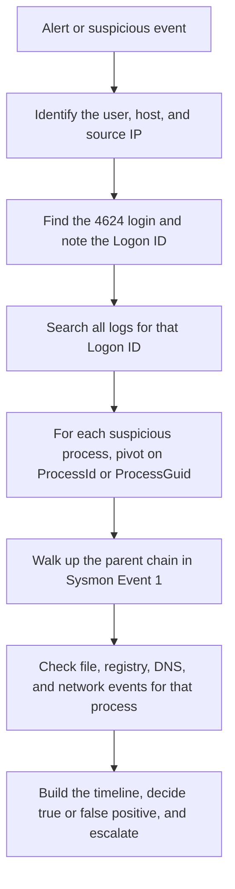

# Windows Logging Essentials: Event ID Reference and Interview Notes

A companion to my [Windows Logging for SOC](https://github.com/angeline-infosec/SOC-Analyst-Lab-Portfolio/blob/main/Windows%20Logging%20for%20SOC/Windows-Logging-for-SOC.md) lab write-up. The lab covers what I did in the room. This file covers what a Tier 1 SOC analyst should know beyond it: a reference for the event IDs that matter, how to correlate them, the attack patterns they reveal, and scenario-based interview questions.

## How to read the source tags

Every reference table has a **Src** column so I know how far to trust each row.

| Tag | Meaning |
|-----|---------|
| **MS** | Checked against Microsoft documentation (primary source) |
| **Room** | Taken from the TryHackMe room |
| **2nd** | Secondary source (vendor or training material). Confirm on Microsoft's event page before relying on it |

Items I have not verified are listed at the end of the reference sections under **Still to verify**.

---

## 1. Where Windows Logs Live

| Log | Where to find it in Event Viewer | What it holds | Src |
|-----|----------------------------------|---------------|-----|
| Security | Windows Logs > Security | Logons, account changes, process creation (if enabled), log clearing | Room |
| System | Windows Logs > System | OS events, service start and stop, service installs, log cleared (104) | 2nd |
| Application | Windows Logs > Application | Events from user-mode applications such as IIS or MS SQL | Room |
| Sysmon | Applications and Services Logs > Microsoft > Windows > Sysmon > Operational | Detailed process, file, registry, DNS, and network events | MS |
| PowerShell | Applications and Services Logs > Microsoft > Windows > PowerShell > Operational | Script Block Logging events (4104) | MS |
| Task Scheduler | Applications and Services Logs > Microsoft > Windows > TaskScheduler > Operational | Scheduled task registration and execution | 2nd |
| RDP session logs | `Microsoft-Windows-TerminalServices-LocalSessionManager/Operational` and `Microsoft-Windows-RemoteConnectionManager/Operational` | Extra RDP connection detail beyond the Security log | 2nd |

**Files on disk:** `C:\Windows\System32\winevt\Logs`, one `.evtx` file per log (Room).

**Time:** Sysmon timestamps are in UTC (MS). Event Viewer's Date and Time column is system time and not necessarily UTC (Room). Normalize before correlating with other sources.

---

## 2. Security Log Event ID Reference

### Authentication and logon

| Event ID | Meaning | Why a SOC analyst cares | Src |
|----------|---------|-------------------------|-----|
| **4624** | Account successfully logged on | Who got in, how (Logon Type), from where, and the Logon ID of the new session | MS |
| **4625** | Account failed to log on | Brute force, password guessing, and user enumeration. Status and SubStatus give the reason | MS |
| **4634** | Account logged off | Ends a session. Matches the 4624 through the Logon ID | MS |
| **4647** | User initiated logoff | More typical than 4634 for interactive and RDP sessions that ended normally | MS |
| **4648** | Logon attempted using explicit credentials | A process used another account's credentials. Commonly scheduled tasks or `Runas`, but also worth checking for misuse | MS |
| **4672** | Special privileges assigned to new logon | A privileged account logged on. It appears alongside 4624 | 2nd |
| **4769** | Kerberos service ticket requested | Kerberos activity, relevant in domain environments | 2nd |

### User and group management

| Event ID | Meaning | Why a SOC analyst cares | Src |
|----------|---------|-------------------------|-----|
| **4720** | User account created | Backdoor accounts | Room |
| **4722** | User account enabled | An old account brought back to avoid attention | Room |
| **4738** | User account changed | Quiet modification of an existing account | Room |
| **4725** | User account disabled | Attackers may disable privileged or SOC accounts | Room |
| **4726** | User account deleted | Cleanup or disruption | Room |
| **4723** | User changed their own password | Normal, but check the context | Room |
| **4724** | Password reset by someone else | Reset then log in as the user | Room |
| **4732** | Member added to a security group | Backdoor added to a privileged group | Room |
| **4733** | Member removed from a security group | Removal of protections or admins | Room |

### Process, persistence, and defense evasion

| Event ID | Meaning | Why a SOC analyst cares | Src |
|----------|---------|-------------------------|-----|
| **4688** | New process created | Process, command line, and parent. Disabled by default and must be enabled. No file hash | Room |
| **4689** | Process exited | Pairs with 4688 for process lifetime | 2nd |
| **4697** | Service installed (Security log) | Common persistence mechanism. Noisy, so focus on sensitive systems | 2nd |
| **7045** | New service installed (System log) | The System-log counterpart of 4697 | 2nd |
| **4698** | Scheduled task created | Persistence and remote execution | 2nd |
| **4699 / 4700 / 4701 / 4702** | Task deleted / enabled / disabled / updated | Changes to existing tasks | 2nd |
| **1102** | Security audit log cleared | Typically should not be seen. Investigate who cleared it and why | MS |
| **104** | A log file was cleared (System log) | Covers other logs, such as System and Application | 2nd |
| **1100** | Event logging service has shut down | Possible tampering or a normal shutdown | 2nd |
| **4719** | System audit policy changed | Someone reduced what gets logged | 2nd |

### Object access

| Event ID | Meaning | Src |
|----------|---------|-----|
| **4656** | File or object handle requested (file change auditing) | Room |
| **4657** | Registry value modified | Room |
| **4663** | Attempt to access an object | 2nd |

The room notes that the Security-log versions for file and registry changes are disabled by default. Sysmon events 11 and 13 cover the same ground with less setup.

### Still to verify (not checked in this session)

- 4768 (Kerberos TGT requested) and 4776 (NTLM credential validation)
- 4740 (account locked out)
- 4728 and 4756 (member added to global or universal group)
- Exact enabling steps and policy paths for 4688

---

## 3. Logon Types (Event 4624 and 4625)

Source for this whole table: Microsoft's documentation of event 4625 (**MS**).

| Type | Title | Meaning | Analyst note |
|------|-------|---------|--------------|
| 2 | Interactive | A user logged on at this computer | |
| 3 | Network | A user or computer logged on from the network | |
| 4 | Batch | Processes running on behalf of a user without direct intervention | Microsoft recommends monitoring for a mismatch, such as Batch used by a member of an administrative group |
| 5 | Service | A service was started by the Service Control Manager | Same mismatch check as Batch |
| 7 | Unlock | The workstation was unlocked | |
| 8 | NetworkCleartext | Network logon where the password reached the authentication package unhashed | Built-in packages still hash credentials before sending them across the network |
| 9 | NewCredentials | A caller cloned its token and specified new credentials for outbound connections | Local identity is the same, but outbound connections use different credentials |
| 10 | RemoteInteractive | Logon through Terminal Services or Remote Desktop | RDP. The key type in my lab |
| 11 | CachedInteractive | Logon using network credentials stored locally | The domain controller was not contacted |

**Reading the 4624 event correctly (Room):**
- Ignore the first Subject block. It often shows `SYSTEM` or the machine account.
- The real user and Logon ID are in **New Logon**.
- Trust the **Source Network Address**. The workstation name is not reliable.

---

## 4. Event 4625 Status and SubStatus Codes

The Status field gives the reason a logon failed. SubStatus gives more detail. Microsoft refers to the NTSTATUS values list for the full set. The codes below are the ones Microsoft's own monitoring guidance for 4625 calls out (**MS**).

| Code | Meaning | What to look for |
|------|---------|------------------|
| `0xC0000064` | Misspelled or bad user account | Several in a row can indicate a **user enumeration** attack |
| `0xC000006A` | Misspelled or bad password | Watch for many in a row, especially on critical or service accounts |
| `0xC000006D` | Bad username or authentication information | Same as above. This was the status in my Task 3 brute force event |
| `0xC000006F` | Logon outside authorized hours | Policy violation or stolen credentials |
| `0xC0000070` | Logon from an unauthorized workstation | Account used from the wrong machine |
| `0xC0000072` | Logon to an account disabled by an administrator | Someone trying a disabled account |
| `0xC000015B` | User not granted the requested logon type at this machine | Logon right missing |
| `0xC0000193` | Logon with an expired account | |
| `0xC0000234` | Account locked out (the typical value for a lockout-related 4625) | A lockout following guessing, or a forgotten password |
| `0xC0000413` | Authentication firewall blocks the account on this machine | |
| `0xC000005E` and `0xC0000192` | No logon server available, and Netlogon not started | Typically infrastructure problems and not security issues |

**Other 4625 fields worth reading (MS):**
- **IpAddress** and **IpPort**: the source. `::1` or `127.0.0.1` means localhost. Port `0` for interactive logons.
- **LogonType**: how the attacker tried to log in.
- **Caller Process ID** (hex) and **Caller Process Name**: Microsoft says you can convert the hex PID to decimal and match it to the New Process ID in a 4688 event.

---

## 5. Sysmon Event ID Reference

Source for this section: Microsoft's Sysmon page (**MS**). Sysmon writes to `Applications and Services Logs/Microsoft/Windows/Sysmon/Operational`.

### The full list

| ID | Event | What it records |
|----|-------|-----------------|
| 1 | Process creation | New process with full command line for the process and its parent, plus hashes |
| 2 | File creation time changed | A process changed a file's creation time |
| 3 | Network connection | TCP and UDP connections. **Disabled by default** |
| 4 | Sysmon service state changed | Sysmon started or stopped |
| 5 | Process terminated | Process ended |
| 6 | Driver loaded | Driver with signature and hashes |
| 7 | Image loaded | Module loaded in a process. **Disabled by default**, needs configuration and is very noisy |
| 8 | CreateRemoteThread | A process created a thread in another process |
| 9 | RawAccessRead | A process read the drive directly using the `\\.\` form |
| 10 | ProcessAccess | A process opened another process |
| 11 | FileCreate | A file was created or overwritten |
| 12 | RegistryEvent (create and delete) | Registry key or value created or deleted |
| 13 | RegistryEvent (value set) | Registry value changed |
| 14 | RegistryEvent (rename) | Registry key or value renamed |
| 15 | FileCreateStreamHash | A named file stream was created |
| 16 | Service configuration change | Sysmon configuration changed |
| 17 | PipeEvent (created) | Named pipe created |
| 18 | PipeEvent (connected) | Named pipe connection made |
| 19 | WmiEvent (filter) | WMI event filter registered |
| 20 | WmiEvent (consumer) | WMI consumer registered |
| 21 | WmiEvent (consumer to filter) | A consumer bound to a filter |
| 22 | DNSEvent | A process made a DNS query, successful or not |
| 23 | FileDelete (archived) | File deleted, and a copy saved |
| 24 | ClipboardChange | Clipboard contents changed |
| 25 | ProcessTampering | Process hiding techniques such as hollowing or herpaderp detected |
| 26 | FileDeleteDetected | File deleted and logged |
| 27 | FileBlockExecutable | Creation of an executable blocked |
| 28 | FileBlockShredding | File shredding blocked |
| 29 | FileExecutableDetected | A new executable (PE) file was created |
| 255 | Error | An error inside Sysmon |

### The events that matter most for detection

| ID | What Microsoft says it helps with |
|----|-----------------------------------|
| **1** | Full command line gives execution context. The ProcessGUID makes correlation easier |
| **3** | Each connection is linked to a process by ProcessId and ProcessGuid |
| **8** | Code injection, where malware hides in other processes |
| **10** | Detecting tools that read the memory of processes like `lsass.exe` to steal credentials. Can be noisy without filters |
| **11** | Monitoring autostart locations like the Startup folder, and temp and download folders, which are common malware drop locations |
| **12 / 13** | Changes to registry autostart locations and specific malware registry changes |
| **15** | Catching browser downloads through the `Zone.Identifier` "mark of the web" stream |
| **2** | Spotting backdoors made to look like they came with the OS. Many legitimate processes change creation times too, so it is not proof alone |
| **19 / 20 / 21** | WMI registrations, a method malware uses to execute |
| **25** | Process hollowing and similar hiding techniques |

### Sysmon facts worth remembering (MS)

- It is a Windows service and a device driver that stays installed across reboots.
- Process image hashes can be SHA1 (the default), MD5, SHA256, or IMPHASH, and several can be used at once.
- The **process GUID** allows correlation even when Windows reuses process IDs. A **session GUID** in each event allows correlation on the same logon session.
- It does not analyze events for you and does not try to hide from attackers.
- Rules include or exclude events. In a config file, rules on the same field act as OR and rules on different fields act as AND.
- Install with a config: `sysmon64 -accepteula -i config.xml`. Update with `sysmon64 -c config.xml`.

### Reading a Sysmon Event ID 1: quick card

| Group | Fields | Question it answers |
|-------|--------|---------------------|
| Process Info | `Image`, `CommandLine`, `CurrentDirectory`, `ProcessId`, `ProcessGuid` | What ran, from where, with what arguments |
| Binary Info | `OriginalFileName`, `Description`, `Company`, `Hashes` | What is the file really. A mismatch between `OriginalFileName` and `Image` suggests a rename |
| Parent Info | `ParentImage`, `ParentCommandLine`, `ParentProcessId` | What launched it |
| User Context | `User`, `LogonId`, `IntegrityLevel` | Who ran it, in which session, with what privilege |

---

## 6. PowerShell Logging

| Source | What it records | Limits | Src |
|--------|-----------------|--------|-----|
| **History file** `C:\Users\<USER>\AppData\Roaming\Microsoft\Windows\PowerShell\PSReadline\ConsoleHost_history.txt` | Every command typed, one file per user | No output, no script content. Survives reboots unless deleted | Room |
| **Script Block Logging** | The content of script blocks PowerShell processes. Event ID **4104** in `Microsoft-Windows-PowerShell/Operational`. Enabled by Group Policy or a registry setting | Microsoft recommends Protected Event Logging, because scripts can write sensitive data like credentials to the log | MS |
| **Module logging** | Pipeline execution events for chosen modules. Event ID 4103 | Must be enabled per module | 2nd |
| **Start and stop events** | Event IDs 4105 and 4106 for script block start and stop | Optional | 2nd |
| **Transcription** | Session input and output saved to a text file with `Start-Transcript` | A file, not an event ID | 2nd |

**Why Sysmon Event ID 1 is not enough:** it logs that `powershell.exe` launched. Every command typed after that runs inside the same process, so no new event appears.

**A note on the suggested next steps at the end of the room (not graded room content):** one of them described Event ID 4104 as a transcript or event forwarding item and mentioned AMSI Event ID 8002. Microsoft's documentation confirms 4104 as **Script Block Logging**. I could not confirm 8002, so it is not in this reference.

---

## 7. Correlation Cheat Sheet

| Identifier | Found in | What it links |
|------------|----------|---------------|
| **Logon ID** | 4624, 4625, 4634, 1102, 4720, 4732, Sysmon 1 (`LogonId`) | A login to everything done in that session. Microsoft states the Logon ID in 4634 and 4625 helps correlate with 4624 |
| **ProcessId / ProcessGuid** | Sysmon 1, 3, 11, 13, 15, 22 | All actions of one process. Prefer the GUID, since Windows reuses process IDs |
| **ParentProcessId / ParentProcessGuid** | Sysmon 1 | A process to its parent, to build a process tree |
| **Source IP** | 4624, 4625, Sysmon 3 | An attacker or remote host across logs |
| **Time (UTC)** | Sysmon `UtcTime` | Ordering events across sources once time zones are aligned |

**Hex and decimal:** Security events show process IDs in hex (`0x19d4`), Sysmon shows them in decimal (`6612`). Convert before comparing. Microsoft's 4625 documentation says the same about matching a Caller Process ID to a 4688 New Process ID.

**General investigation workflow:**

---

## 8. Common Attack Patterns and Their Log Trail

This table is my own synthesis from the sources above. The event IDs are from the reference tables, and the pattern is analyst reasoning.

| Pattern | What the logs show | Where |
|---------|--------------------|-------|
| **Brute force then RDP access** | Many 4625 from one IP, then a 4624 Type 10 from that IP | Security |
| **User enumeration** | Several 4625 events with `0xC0000064` in a row | Security |
| **Backdoor account** | 4720 followed by 4732 into a privileged group, from an unexpected session | Security |
| **Malicious download and run** | Sysmon 15 (Zone.Identifier with source URL), then Sysmon 1 from the Downloads folder | Sysmon |
| **Persistence in Startup folder or Run key** | Sysmon 11 in a Startup folder, or Sysmon 12 or 13 on autostart registry keys | Sysmon |
| **Persistence by service** | 4697 (Security) or 7045 (System) | Security, System |
| **Persistence by scheduled task** | 4698, and Task Scheduler Operational events | Security, Task Scheduler |
| **Command and control** | Sysmon 22 (DNS lookup), then Sysmon 3 (connection) from an unexpected process | Sysmon |
| **Credential theft from LSASS** | Sysmon 10 where another process opens `lsass.exe` | Sysmon |
| **Code injection** | Sysmon 8 (CreateRemoteThread) | Sysmon |
| **Log clearing** | 1102 for Security, 104 for other logs | Security, System |
| **PowerShell abuse** | 4104 script block events, and the per-user history file | PowerShell, disk |
| **Timestomping** | Sysmon 2, treated with caution because it has legitimate causes | Sysmon |

---

## 9. Scenario-Based Interview Questions

The answers describe how I would work through each situation as a Tier 1 analyst: what to check, how to decide, and when to escalate.

### Authentication

**Scenario 1: You see around 200 failed logons (4625) from one external IP over five minutes, followed by a 4624 with Logon Type 10 from the same IP. What do you do?**

This looks like a successful brute force against RDP. I would:
1. Count the failures and note the time window and the account names targeted.
2. Read the Status codes (`0xC000006A` and `0xC000006D` point to password guessing).
3. Open the 4624 and note the account, Logon Type, source IP, and **Logon ID**.
4. Search every log for that Logon ID to see what the session did: new accounts (4720), group changes (4732), processes (Sysmon 1), and log clearing (1102).
5. Check whether the IP belongs to a known scanner or an approved test.

If nothing explains the source, I would treat it as a true positive and escalate with the evidence. I would recommend containment (block the IP, reset the credentials, isolate the host) and let the incident response process approve it.

**Scenario 2: Many 4625 events appear, each with a different username and status `0xC0000064`. What does that suggest?**

`0xC0000064` means the account name does not exist. A run of them across different names suggests someone is guessing or enumerating usernames, and Microsoft's guidance names user enumeration for this case. I would check the source IP, the volume, and whether any 4624 follows from that IP. If a real account is later hit with a different code, such as `0xC000006A`, the attacker may have found a valid name.

**Scenario 3: An account keeps getting locked out. What do you check?**

A lockout-related 4625 typically carries `0xC0000234`. I would check where the failed attempts originate (source IP and workstation name), what process is asking (Caller Process Name), and what Logon Type is used. A single machine repeating attempts can be a forgotten credential in a service or scheduled task. Attempts from many sources or from outside the network point to an attack.

**Scenario 4: You find a 4648 event. Is that a problem?**

Not on its own. It means a logon was attempted with explicit credentials, which commonly happens with scheduled tasks and `Runas`. I would check the Subject account, the target account, the process that made the request, and whether the pairing is expected. A user or process suddenly using explicit credentials for an account it should not touch deserves a closer look.

**Scenario 5: A member of the domain admins group shows a Logon Type 4 or 5 logon. Why might that matter?**

Types 4 (Batch) and 5 (Service) are meant for scheduled tasks and services. Microsoft's monitoring guidance specifically flags these types being used by members of administrative groups. I would check which task or service uses the account and whether that is documented.

**Scenario 6: An alert shows a 4624 where the workstation name does not match the machine the IP belongs to. Which do you trust?**

The source IP. The room points out that the workstation name in the event is not reliable. I would still keep in mind that the IP can be a VPN, proxy, or NAT address and look for supporting evidence.

### Account management

**Scenario 7: A new local administrator account was created at 3 AM. How do you investigate?**

1. Open the 4720. Note the new account name, the Subject account, and the **Logon ID**.
2. Check for a 4732 adding the account to a privileged group.
3. Find the 4624 with the same Logon ID to learn how and from where the session started.
4. Ask IT whether the account was requested. Red flags from the room: no one confirms it, it happened out of hours, the creating account is unexpected, or the name breaks the naming pattern.

If the session traces back to a suspicious login, I would escalate it as a possible backdoor.

**Scenario 8: A colleague says "that `svc_` account is probably just Windows, leave it". How do you respond?**

I would not assume. Backdoor accounts often use names that look like service accounts. I would check who created it and when, which groups it joined, and whether its creation Logon ID ties to a suspicious login. If nobody can confirm it, I would escalate.

### Process and execution

**Scenario 9: An alert says `WINWORD.EXE` launched `cmd.exe`. How do you verify it?**

In Sysmon, I would filter Event ID 1 for the `cmd.exe` process and read `ParentImage`. A Word-to-command-prompt chain is a strong sign of a macro executing code. Then I would read the `CommandLine` (what it ran), check what that process did next (downloads, file drops, network), and look at the Word document that was opened. Without Sysmon, 4688 gives the command line and parent too, if enabled.

**Scenario 10: You find a process running from a user's Downloads folder with a random name. What next?**

1. Read the Event 1 fields: `Image`, `CommandLine`, `OriginalFileName`, `Hashes`, and parent.
2. Compare `OriginalFileName` with the file name. A mismatch suggests a rename.
3. Search the hash on VirusTotal.
4. Pivot on the ProcessId or ProcessGuid for file (11), registry (13), DNS (22), and network (3) events.
5. Use Event 15 to find where the file was downloaded from.

**Scenario 11: How do you find out where a downloaded file came from?**

Look for Sysmon Event ID 15 (FileCreateStreamHash). Browsers attach a `Zone.Identifier` stream, the "mark of the web", and Microsoft notes this event is meant to catch browser-delivered malware. The stream contents include the source URL in the `HostUrl` field.

**Scenario 12: A process makes an outbound connection on port 7777 to an IP you do not recognize. What do you check?**

I would find the Event 3 and note the `ProcessId`, then find the matching Event 1 to see what the process is, who launched it, and where it lives. I would look for a DNS query (Event 22) shortly before the connection, check the domain and IP reputation, and check whether the process was recently downloaded. A non-standard port, a suspicious domain ending, and a process from a user folder together point to command and control.

**Scenario 13: You see Sysmon Event 10 where an unknown process opens `lsass.exe`. How serious is it?**

It is serious until explained. Microsoft notes this event exists to catch tools that read the memory of processes like LSASS to steal credentials. I would identify the process doing the access (and its parent and hash), check whether it is a known security tool, and treat an unknown one as a possible credential theft attempt and escalate.

**Scenario 14: Why do you use ProcessGuid and not just the PID?**

Windows reuses process IDs, so the same PID can belong to different processes at different times. Microsoft states the process GUID in Sysmon exists to correlate events even when process IDs are reused.

**Scenario 15: Sysmon is not installed on the host. What can you rely on?**

The 4688 process creation event if it is enabled (it is off by default and has no file hash), the PowerShell history files, other Security log events, and any EDR telemetry. I would recommend installing Sysmon with a maintained configuration so process, file, registry, DNS, and network events are all available.

### Persistence and evasion

**Scenario 16: A new service is installed with its binary in a temp folder. What do you do?**

Check the 4697 in the Security log or 7045 in the System log: the service name, the binary path, and the account that created it. A path in a temp or user-writable folder is a red flag the room's process workbook also lists. Then find the Logon ID of the creating session and investigate how that session started.

**Scenario 17: A scheduled task was created outside business hours. How do you investigate?**

Read the 4698: the task name, the actions it runs, and the creator. Check the Task Scheduler operational log for the registration event and later runs. Trace the creator's Logon ID back to the login. A task that runs a script or executable from a user folder, created from a remote session, should be escalated.

**Scenario 18: You find a file in a Startup folder created by an unknown process. Is that persistence?**

Likely. Files in the Startup folder are processed when the user logs in, and Microsoft notes Sysmon Event 11 is useful for monitoring that location. I would find which process created it (the `ProcessId` in the Event 11), look at that process's Event 1, and check what the file contains or points to.

**Scenario 19: You discover event 1102. What does it mean and what do you do?**

The Security audit log was cleared. Microsoft says you typically should not see it and recommends investigating why it happened. I would read the Subject account and Logon ID, trace the session back to its login, and look at what happened before the clear in other logs, including copies sent to the SIEM, since the local log is gone. A cleared log after a suspicious login is a strong sign of an attacker covering tracks.

### PowerShell

**Scenario 20: An incident involved PowerShell, but process logs show only one `powershell.exe` event. Where do you find the commands?**

The process log shows only the launch, because every command runs inside that one process. I would check each user's `ConsoleHost_history.txt` file, and Script Block Logging events (4104) if enabled. The history file has limits: no output and no script content. In my lab, a user's history showed discovery commands, saved results, and a cleanup command.

**Scenario 21: What would you flag in a PowerShell history like this: `get-localuser`, `get-smbshare`, `ipconfig /all`, output to files, then `clear-recyclebin`?**

A discovery routine followed by cleanup: listing users, shares, and network configuration, saving the results, and deleting traces. On its own it could be an administrator, so I would confirm with the user, check the logon and time, and look for what happened after the results were collected.

### Judgment and process

**Scenario 22: What is the difference between event 4688 and Sysmon Event 1?**

Both log process creation with a command line and parent. 4688 is in the Security log, is disabled by default, and has no file hash. Sysmon is a separate tool that must be installed, and its Event 1 adds hashes and more, with companion events for files, registry, DNS, and network.

**Scenario 23: Two sources show the same event with different times. Why?**

Time zones. Sysmon records UTC, while Event Viewer's Date and Time column is system time. I would convert everything to a single time zone before building a timeline.

**Scenario 24: An EDR alert flags an unsigned binary making network connections. Is it malware?**

Not necessarily. In an EDR lab I worked on, the same pattern was malicious in one case and a known internal IT tool in another. I would check the path, the parent, the hash, threat intelligence, and the business context before deciding, because acting on a false positive can disrupt legitimate work.

**Scenario 25: You have three alerts at once: a log clearing event, a failed-logon burst from the internet, and a new scheduled task. How do you prioritize?**

This is a judgment call. I would start with the log clearing, because it suggests someone already has privileged access and is hiding it. Next, the scheduled task, which could be persistence. The failed-logon burst alone only shows an attempt unless a success follows, though I would check quickly whether it did. I would also check whether the three alerts share a host, account, or Logon ID, since they could be one incident.

### Quick-fire concept questions

| Question | Short answer |
|----------|--------------|
| Where are Windows logs stored? | `C:\Windows\System32\winevt\Logs`, as `.evtx` files |
| Which event is a successful logon? A failed one? | 4624 and 4625 |
| Which Logon Type is RDP? | 10 (RemoteInteractive) |
| Which event shows a user was created? Added to a group? | 4720 and 4732 |
| Which event means the Security log was cleared? | 1102 |
| Which Sysmon event is process creation? Network? DNS? File create? | 1, 3, 22, 11 |
| Which Sysmon event is off by default? | 3 and 7 |
| Which Sysmon event catches browser downloads? | 15 (Zone.Identifier) |
| Which Sysmon event can show LSASS memory access? | 10 |
| Which event logs PowerShell script content? | 4104 (Script Block Logging) |
| What links a login to later activity? | The Logon ID |
| What links all events from one process? | The ProcessGuid (or ProcessId) |

---

## 10. What to Study Next

- Kerberos and NTLM authentication events (4768, 4769, 4776), which are still unverified in this reference
- Account lockout events (4740) and group-change events for domain environments
- Windows Event Forwarding and how events reach a SIEM
- AMSI and PowerShell transcription (the room's follow-up suggestions)
- TryHackMe's Sysmon room and Logless Hunt room, which the lab itself recommends
- SOC-SIM, where these log sources are used in simulated alerts
